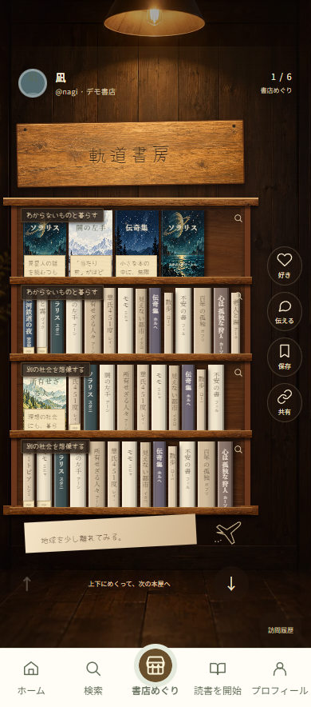
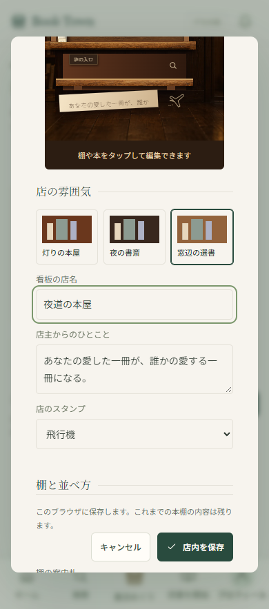
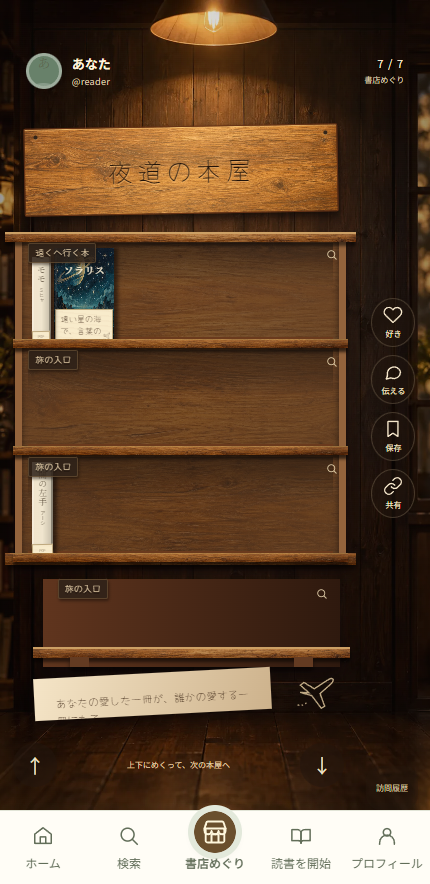

# 書店めぐりと店内の飾りつけの設計（2026-10-12 の引き継ぎ資料）

> 更新日: 2026-10-20（2026-10-12 の内容に、今との違いを書き足した）
>
> この資料は、書店めぐり（`/walk/`）と自分の店内の飾りつけの設計と、保存で壊してはいけないことの記録です。**今の作業の始め方は [CLAUDE.md](../CLAUDE.md) と [資料の索引](README.md) にあります。** 最新のコードは `main` で、作業は `main` から新しいブランチを切って始めます。
>
> 今も守るのは、2章の設計の方針と、6章の「保存と移行で壊してはいけないこと」です。4章の実装済みの体験、7章の検証の数、8章の「未実装」は 2026-10-12 時点の記録で、今の仕様ではありません。そのあとにログインと Supabase への保存などが入りました（[docs/09](09_段階2_ログインと保存.md)）。

## 1. どのコードから続けるか

Phase 1・2（旧PR #6・#7）と、使い勝手の改善（旧PR #3）・POPの切り替え（旧PR #5）は、2026-10-12 にブランチ `claude/book-town-sns-features-3ij9a9` 経由で `main` にまとめました。`feat/woodshop-phase2-20261012` などの古いブランチから続けないでください。

このころの確認用の公開先（Sites）は、今は使っていません。今の公開先は Vercel で、`main` への取り込みがそのまま本番（https://booktown.page）になります。

## 2. ユーザーが目指しているもの

一人ひとりが自分だけの本屋を開ける読書SNS（BookTown）です。実際の書店に入って、本棚をいつまでも眺めてしまう体験を目指しています。

完成イメージは、温かな照明、使い込んだ木の看板と棚、上段に正面の表紙と手書きPOP、下段に多くの背表紙とところどころの面陳、旅・日常・心などの棚札を持つ本屋です。元の完成イメージ画像はユーザーが会話に添付したもので、このリポジトリには同梱していません。厳密な画像比較をする場合は、ユーザーから同じ画像を受け取ってください。

守る方針:

- 本棚を主役にし、SNSのボタンは脇役にする。
- 奥行き・質感を持たせる。本を背景画像に描き込むだけで済ませない。
- 本は独立してタップでき、同じ本でも置く場所ごとにPOPを持つ。
- 背表紙と表紙、棚札、POPを自然に組み合わせる。
- 店の表示とBook・配置・POP・Theme・Layoutのデータを分離する。
- 見た目が変わっても基本操作はそろえる。スマホの押しやすさ、読み込みとスクロールの性能を重視する。
- 将来のテンプレート・スタンプ・編集機能を追加できる構造にする。次の範囲はユーザーの指示で決める。

## 3. 現在の画面

以下はPhase 2のローカル検証画面です。編集画面と自分の店は検証用データを使用しており、ユーザーの保存済み選書を公開したものではありません。

### スマホの書店めぐり



### 店内を編集する画面



### 保存した自分の書店



参考画像の写真そのものの再現は、まだできていません。現在の改善は木目、仮装丁、紙と手書きのPOP、および操作・編集体験です。

## 4. 実装済みの体験

- `/walk/`: 9:16の木製書店を1軒ずつ巡る。上下スワイプ、ホイール、上下キー、前後ボタンで店を切り替える。順番は巡回開始時に固定する（まだ訪れていない書店から、次に訪れたのが古い順）。終わりはなく、最後の書店の次は最初の書店に戻って「街をひと回りしました」と知らせる。街の路地（ホーム）も、最後の書店のあとに並びを変えた次の路地が続く。
- 本は棚の独立した要素。細い背表紙は段を拡大して選べる。本を手に取り、同じ家具内の上段から下段、左から右の順で隣の本を読める。
- 本の詳細内でPOPだけを左右のボタン・スワイプで切り替えられる。本そのものは変わらず、店主・プロフィール・書店リンク・スタンプ・反応が切り替わる。別の本へ移るとPOPは最初へ戻る。
- 非公開棚・本、未配置の本、非表示家具の子を公開閲覧・POP検索から除外する。
- 訪問履歴、途中再開、店への好き・保存をブラウザ内に保持。「店主に伝える」は実際には送信せず、手元にだけ保存するデモ。
- `/my-shop/` の「店内を飾りつける」から、自分の書店だけを編集できる。
- 灯りの本屋／夜の書斎／窓辺の選書の3テンプレート。看板、店主の言葉、棚札、棚と本の公開範囲、本の追加・順番・面陳／背表紙、POP、飛行機・コーヒー・葉っぱのスタンプを編集できる。
- テンプレート変更で本やPOPのIDを保つ。入りきらない本や下ろした本は未配置へ残し、POPとスタンプも保持する。未配置から棚へ戻せる。
- キャンセルは下書きを破棄。保存失敗では下書きを開いたまま保持し、保存済みの店内を変更しない。
- 旧ホーム・タイムライン・読書・プロフィール・書店ページ・旧エディタを維持。

## 5. 最初に読むコード

| ファイル                                                                                      | 役割                                                              |
| --------------------------------------------------------------------------------------------- | ----------------------------------------------------------------- |
| [types.ts](../src/lib/types.ts) / [data.ts](../src/lib/data.ts)                               | Book・旧Shop/Shelf等の型と既存デモデータ                          |
| [store-scene.ts](../src/lib/store-scene.ts)                                                   | 家具→段→BookPlacement→POPの構造、座標・回転、配置検証・再配置     |
| [store-scene-adapter.ts](../src/lib/store-scene-adapter.ts)                                   | 旧棚から初期Sceneを生成し、読書順と公開POPを作る                  |
| [store-customization.ts](../src/lib/store-customization.ts)                                   | 3テンプレート、非破壊移行、公開用のScene、POP・順番・未配置の編集 |
| [walk-state.ts](../src/lib/walk-state.ts)                                                     | 巡回順、履歴、途中位置、訪問判定、ジェスチャーの判定              |
| [walk-repository.ts](../src/lib/walk-repository.ts)                                           | v1/v2のWalk保存、破損・未知バージョンの保持                       |
| [walk-store.ts](../src/lib/walk-store.ts)                                                     | Reactの共有状態、保存に成功したSceneだけを採用                    |
| [WalkView.tsx](../src/components/WalkView.tsx)                                                | 書店めぐりの画面・操作と公開Sceneの適用                           |
| [StoreCanvas.tsx](../src/components/StoreCanvas.tsx) / [walk.css](../src/components/walk.css) | 独立した本・家具・POP・棚札の描画と質感                           |
| [StoreSceneEditor.tsx](../src/components/StoreSceneEditor.tsx)                                | 自分の店内の編集、プレビュー、保存・キャンセル                    |
| [ShopEditor.tsx](../src/components/ShopEditor.tsx)                                            | 旧エディタを維持し、新しい店内編集への入口を追加                  |
| [BookInHand.tsx](../src/components/BookInHand.tsx)                                            | 本の詳細、本とPOPの別々の切り替え、反応の対象                     |
| [ShelfZoom.tsx](../src/components/ShelfZoom.tsx)                                              | 同じ段に近づいて本を選ぶ                                          |
| [book-art.ts](../src/lib/book-art.ts) / [ui.tsx](../src/components/ui.tsx)                    | 仮装丁のアトラス選択、BookJacket等の共有部品                      |
| [TownApp.tsx](../src/components/TownApp.tsx)                                                  | 既存画面との統合とナビゲーション                                  |

## 6. 保存と移行で壊してはいけないこと

### 旧保存

`book-town-v1`、version 1。旧Shop・Shelf・投稿・読書などの保存キーとデータは維持しています。

### 書店めぐりの保存

キーは `book-town-walk-v1` のまま、内容は `{schemaVersion:2, walkState, sceneOverrides, legacyBackups}` です。Phase 1のschemaVersion 1を読み込み、履歴・順番・反応・Sceneを失わずに扱います。未知のバージョンや破損した文字列は保持し、上書きしません。

Scene自体のschemaVersionは1。`ownerManaged` と `templateId` は任意の追加項目です。初回の店内編集で旧公開棚をコピーし、旧非公開棚の本とPOPは非公開・未配置として保持します。初回保存に成功すると旧Shopのコピーを1回だけバックアップし、新Sceneを採用します。

`ownerManaged` なSceneがある書店では、**そのSceneが書店めぐりの正本**です。再編集時に旧棚で新しいPOPや公開設定を上書きしません。旧書店ページ・プロフィール・旧本棚は旧Shelfを読むため、新Sceneとはまだ自動同期しません。画面にも別保存と明記しています。今後の統合では、この境界を理解して非破壊で進めてください。

- POPの親はBook IDではなく配置IDです。同じBookの複数配置を混同しない。
- Sceneの反応キーはJSON配列 `["scene", storeId, placementId]`。移行時に旧反応をコピーし、既存のScene反応は上書きしない。
- 段を公開するだけでは、明示的に非公開にした本を公開しない。
- テンプレート変更で非公開の段から本が移っても、自動で公開しない。
- 棚から下ろす・容量超過・家具削除で、本とPOPを消去しない。
- 保存前に`validateScene`等で参照、境界、重なり、公開フラグを検証する。書き込みが成功してから採用する。

## 7. 起動・検証

既存の作業変更がある場合は、`git status` を確認し、失わない方法でブランチを切り替えてください。

新規に取得する場合:

```sh
git clone https://github.com/mitsuakisudo2-dot/book-town.git
cd book-town
pnpm install
pnpm dev
```

ローカルは `http://127.0.0.1:5173/walk/`、編集は `/my-shop/`。Node.js 22.13以降・pnpm 11。実装時の検証環境はNode 24.19、Next.js 16.4です。Next.jsのAPIは、このリポジトリの`AGENTS.md`に従ってインストール済みドキュメントで確認してください。

検証コマンド:

```sh
pnpm typecheck
pnpm lint
pnpm test:domain
pnpm test:walk-domain
pnpm test:customization-domain
pnpm build
```

ブラウザテストは、プレビューを起動したまま別のターミナルで実行します。既定ではPlaywrightのChromiumを使います。ほかのブラウザで試すときは `BOOK_TOWN_CHROME` にその実行ファイルを指定してください。`BOOK_TOWN_URL` でテスト先、`BOOK_TOWN_QA_OUTPUT` で結果保存先を変更できます。

```sh
pnpm test:walk
pnpm test:customization
pnpm test:street
pnpm test:app
```

Phase 2実装コミットでの実測（2026-10-12 時点。今のテストの一覧は `package.json` と [開発の引き継ぎ](開発の引き継ぎ.md)）:

| チェック                       | 結果         |
| ------------------------------ | ------------ |
| TypeScript / lint / diff check | 成功         |
| 静的ビルド                     | 49ページ成功 |
| 既存domain                     | 41項目成功   |
| walk domain                    | 23項目成功   |
| customization domain           | 16項目成功   |
| walk browser                   | 17項目成功   |
| customization browser          | 13項目成功   |
| street browser                 | 24項目成功   |
| app browser                    | 18項目成功   |

合計152項目。320/375/390/430pxとPC・短い画面で確認。公開後にも本を開き、POPが1/4から2/4へ切り替わり、店主・書店リンクが更新されることを確認しました。実機iOS/Android/Safariの速度と触感は未確認です。文書だけの追加で152項目を再実行した、という意味ではありません。

## 8. 素材と、2026-10-12 時点の限界

- [素材の記録](../public/themes/woodshop/ASSETS.md): 背景・仮装丁・木目は独自素材。仮装丁は8種の共有アトラス、書名・著者はHTML。実在の表紙を複製していません。
- [Yomogiのライセンス](../public/fonts/Yomogi-OFL.txt)を保持。手書きフォントは軽量サブセットで、収録外の漢字は明朝系フォントへ戻ります。
- （2026-10-12 時点）共有DB、正式なログイン、他端末同期は未実装で、保存はこのブラウザのみでした。今はログインした人の街と書店めぐりを Supabase に保存します（[docs/09](09_段階2_ログインと保存.md)）。
- 新しい店内と旧書店ページ・プロフィールの自動同期は未実装。
- 家具の自由配置・サイズ変更、画像アップロード、背景・照明・フォントの詳細設定、テンプレート・スタンプの追加登録UIは未実装。
- 実際のメッセージ送信、匿名交流、POPの履歴保存、通知やSNS共有の追加、公式アカウント、課金などは今回の実装範囲に含めていません。既存の機能と混同しないでください。

次の論点は、実機評価、参考画像へのさらなる質感調整、旧表示とSceneの統合、テンプレート・スタンプ拡充です。ユーザーの次の具体的な指示を確認して範囲を決めてください。

## 9. 設計資料の読む順番

まず [AGENTS.md](../AGENTS.md) と [設計資料の索引](README.md)、次に [Phase 1](07_書店めぐり_Phase1.md) と [Phase 2](08_書店めぐり_Phase2.md)。既存SNSの今の設計は [CLAUDE.md](../CLAUDE.md) と [docs/09](09_段階2_ログインと保存.md) にあります。索引の01〜06は構想段階の経緯の記録です。確定事項・試作値・未決定案を区別し、最新のユーザー指示を優先します。
